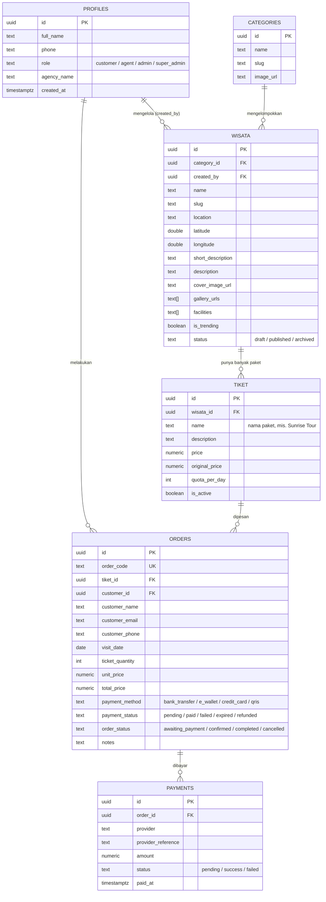

# ERD Explore Malang (Sesuai Implementasi Database Aktual)

Diagram ini mencerminkan skema yang benar-benar berjalan di `supabase/schema.sql`,
berbeda dari draft ERD awal karena sudah memisahkan **Wisata** (info tempat) dan
**Tiket** (paket harga) supaya satu wisata bisa punya banyak pilihan paket.

Cara pakai: copy blok kode di bawah, paste ke https://mermaid.live untuk lihat
visualnya, atau tempel langsung ke laporan/skripsi kalau tool dokumentasi Anda
mendukung Mermaid (Notion, GitBook, banyak plugin Word/LaTeX juga mendukung).

## Perbedaan dengan draft ERD awal

| Draft ERD awal | Implementasi sekarang | Alasan |
|---|---|---|
| `harga_tiket` langsung di tabel Wisata | Tabel `tiket` terpisah, relasi Wisata 1—N Tiket | Satu wisata bisa punya beberapa paket (mis. "Sunrise Tour" vs "Tiket Masuk Saja"), masing-masing harga & kuota sendiri |
| Tabel `Gambar` terpisah (id_gambar, gambar, id_wisata) | Kolom `gallery_urls text[]` di tabel Wisata | Lebih sederhana untuk skala kecil-menengah; jumlah galeri per wisata dibatasi (maks 6) lewat validasi di form, bukan tabel relasi |
| Tabel `Metode Pembayaran` (master: Qris/Bank/E-Wallet) | Kolom `payment_method` bertipe enum/text di Orders | Pilihan metode tetap (4 opsi tetap dari Midtrans), tidak butuh tabel master terpisah karena tidak akan ditambah dinamis oleh admin |
| Transaksi & Pembayaran relasi campur | `orders` (data pesanan) terpisah jelas dari `payments` (log setiap percobaan pembayaran) | Satu order bisa punya beberapa baris payment (mis. retry setelah gagal), sesuai kebutuhan integrasi Midtrans/webhook |
| `User.role` | `profiles.role`: customer / agent / admin / super_admin | Ditambah `agent` untuk agen travel dan `super_admin` untuk pemisahan kewenangan sesuai use case diagram |

Kalau untuk keperluan skripsi/laporan dosen pembimbing mengharuskan struktur
persis seperti draft ERD awal (satu harga per wisata, tabel Gambar & Metode
Pembayaran terpisah), beri tahu saya — bisa saya buatkan migrasinya, tapi
dengan konsekuensi fitur "banyak paket tiket per wisata" akan dihapus.
